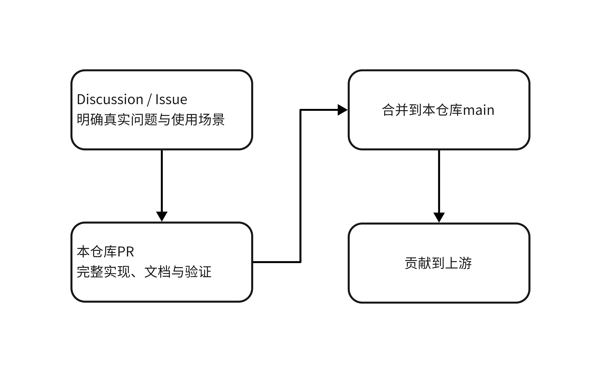

# 贡献指南

欢迎贡献新的软件工程 Skills，或改进现有 Skills。提交前先阅读[收录范围](./SCOPE.md)。本仓库独立评审贡献，合入不代表上游 `mattpocock/skills` 会收录。

## 软件工程 Skills

### 选择提交入口

| 贡献类型 | 入口 |
| --- | --- |
| 新 Skill，已有真实场景和完整实现 | 直接提交完整 PR |
| 新 Skill，只有想法或方向不确定 | [Discussion Ideas](https://github.com/vinvcn/mattpocock-skills-zh-CN/discussions/categories/ideas) |
| 现有 Skill 的小型修复 | 直接提交 PR |
| 现有 Skill 的行为大改 | 先开 issue 描述真实问题和修改方向 |
| 使用问题 | [Discussion Q&A](https://github.com/vinvcn/mattpocock-skills-zh-CN/discussions/categories/q-a) |
| 术语翻译 | 见下方「翻译术语：请求与认领」 |

Discussion 是交流渠道，不是预先批准，也不是提交 PR 的前置条件。Ideas 用于讨论真实案例、适用范围和与现有 Skills 的关系；形成明确方向后，PR 可以链接该 Discussion 作为背景。一个 PR 聚焦一个 Skill 或一个问题，避免把多个无关改动捆在一起。

### 完整贡献流程

推荐工作流为：



合并到 `main` 后继续在真实使用中验证；有上游分享价值时，先重新核对上游当时政策，再通过其允许的渠道贡献。

#### 1. Discussion / Issue：明确问题，不预先批准实现

Discussion 适合交流新 Skill 的初步想法、真实使用场景、复用范围，以及与现有 Skills 的关系。Issue 适合跟踪现有 Skill 的具体问题，或承接已经明确范围的改进。

讨论或 issue 可以沉淀真实问题、典型输入、预期行为、不适用场景和验收标准。维护者参与讨论、点赞或创建 issue 都不等于承诺收录。

#### 2. PR：提交可评审的完整方案

PR 需要说明真实问题、使用场景、与现有 Skills 的区别，以及验证方式。新增 Skill 还应提供完整的仓库集成和新增列表条目。一个 PR 聚焦一个 Skill 或一个问题。

评审重点包括问题是否真实、能否复用、是否适合独立存在、行为是否可靠，以及长期维护成本。方向性变化应回到 Discussion 或 Issue 补充原因；检查失败必须如实记录。

#### 3. Merge：成为本仓库正式内容

维护者确认评审问题已解决、必需检查通过、文件范围清楚后，合并到 `main`。合入表示本仓库愿意维护这个 Skill，不代表上游认可，也不自动产生上游贡献义务。

本仓库原创 Skill 在合入时加入 README 的「本仓库新增 Skills」区域，注明来源；从上游翻译或同步得到的 Skill 不进入该区域。

#### 4. 合并后的真实验证

在真实项目中继续调用，记录正确触发、未触发、误触发和边界情况，并修正首次实现未覆盖的问题。能够合入本仓库，不等于已经证明值得上游收录。

#### 5. Upstream contribution：独立评估，按上游政策行动

准备向上游分享时，重新核对其 `CONTRIBUTING.md`、`SCOPE.md`、`.out-of-scope/`、issue 表单和 Discussions 规则，不把本仓库的流程套用到上游。

当前新增 Skill 的可行路径是整理真实使用证据，通过上游 Discussions 分享实践与反馈，而不是在本仓库合并后直接向上游提交新 Skill PR。修改上游现有 Skill 时，按其规则提交包含真实失败、复现步骤、实际与预期行为、harness、模型和版本的 issue，可附本仓库实现作为参考。

上游是否参考、采纳或调整政策由上游独立决定。若之后被上游收录，本仓库新增列表保留历史记录并补充上游链接；若上游政策变化，再评估是否正式提交 PR。

### 新增 Skill 的 PR

PR 正文需要回答：

1. 它解决什么真实问题？请给出实际项目或 session 中的使用场景。
2. 用户会在什么时候调用它，期望得到什么行为？
3. 为什么不能只组合或改进现有 Skills？
4. 如何验证它按预期工作？

至少提供一个具体输入示例和预期行为。优先提供真实 session 中的证据，不必粘贴完整私有项目或大段日志。

### 仓库规范

新增或修改 Skill 时，遵循 [仓库指南](./AGENTS.md) 和 [调用规范](./docs/invocation.md)：

- 提供完整的 `SKILL.md` 与 `agents/openai.yaml`，正确选择 **Model-invoked** 或 **User-invoked**，并保持 frontmatter 与调用策略一致。
- 使用简体中文说明，保留 identifiers、代码、路径、URL 和行为关键 labels；行文不使用破折号。未决定的术语按下方流程提出请求。
- 更新顶层 README、对应 bucket README、`.claude-plugin/plugin.json` 以及受影响的 `ask-matt` 路由。
- 更新 dsh 的技能名单、技能总数、文档和相关测试。`dsh-plugin/skills/` 由构建生成，不手工编辑。
- 派发 subagent 的 Skill 必须要求使用全新的 context window。
- 只提交本 PR 需要的文件，不包含构建产物或无关修改。

### 本仓库新增 Skills 列表

本仓库原创、且上游尚不存在的 Skill，合入时同步加入顶层 README 的「本仓库新增 Skills」区域：

- 每个条目链接到对应 `SKILL.md`，简介保持一行。
- 「来源」填写 `本仓库维护者` 或 `社区贡献`；社区贡献链接贡献者或原始 PR。
- 从上游翻译、刷新或同步得到的 Skill 不进入该列表。
- Skill 改名或移除时同步更新条目；若之后被上游收录，保留记录并注明上游链接。

### 验证

先 `git add` 暂存改动，再运行：

```bash
node scripts/check-translation.mjs
node scripts/audit-english.mjs
git diff --check
npm --prefix dsh-plugin run build
npm --prefix dsh-plugin test
npm --prefix dsh-plugin run verify
```

修改 `.claude-plugin/plugin.json` 或 marketplace manifest 后，还要运行：

```bash
claude plugin validate . --strict
```

翻译检查脚本只扫描已跟踪文件。`audit-english` 的输出需要人工复核，技术术语和 identifiers 可以保留。若检查因已有问题失败，在 PR 中列出失败项、原因和与本 PR 的关系，不把失败描述成通过。

### 评审与合并

维护者按[收录范围](./SCOPE.md)评审问题是否真实、能否复用、是否适合独立存在，以及维护成本是否合理。通过评审后，由维护者合并到 `main`，不承诺评审时限或必然合并。

使用 AI 协助写作或生成内容是可以的，但提交者必须阅读、验证并对 PR 的准确性负责。不要提交自己没有理解或无法解释的 Skill。

## 与上游的关系

本仓库合并贡献，不代表上游认可或收录。上游 `mattpocock/skills` 当前**不接受外部新增 Skill 的贡献，包括已经准备好的 fork 或分支**；其 PR 也仅协作者可创建。贡献者不需要自行向上游提交 PR。

上游允许通过 Discussions 交流新 Skill 想法，但这不等于接受纳入。维护者可以关注上游政策变化，并通过其允许的交流渠道分享实践。针对上游现有 Skill 的具体问题，应按其规则提交 issue。上游是否采纳由上游独立决定。

当前上游规则以 [SCOPE.md](https://github.com/mattpocock/skills/blob/main/SCOPE.md)、[新 Skill 政策](https://github.com/mattpocock/skills/blob/main/.out-of-scope/new-skills.md)和 [贡献指南](https://github.com/mattpocock/skills/blob/main/CONTRIBUTING.md)为准。提交上游贡献前，请重新核对这些最新文档。

## 中文表达反馈

发现生硬直译、中英混杂或难懂的 AI 输出时，欢迎开 issue，附上原文、出现位置或使用的 skill，以及你期望看到的效果。不需要先提出完整译法，也不需要会改代码。

术语讨论先以自然、准确、一致、可执行为标准，不追求逐字对应。可以认领单个文件或一个段落的小范围改进；多个文件需要采用同一种译法时，先按下面的流程确定术语，避免每个文件各写一套。

## 翻译术语：请求与认领

1. 任何人都可以为仓库里发现的英文术语开 issue 请求翻译。请求包含：术语、出现位置（`文件:行`，可列多处）、可选建议译法、可选理由。参考示例：[#34](https://github.com/vinvcn/mattpocock-skills-zh-CN/issues/34)。
2. 讨论后由维护者决定译法；决定的术语登入 [翻译术语表](./TRANSLATION-GLOSSARY.md) 的「已决定的翻译」表。
3. 任何人都可以认领已决定的术语并开 PR 落地：按术语表替换仓库中的出现位置（大小写不敏感匹配）；PR 描述链接术语表条目与相关 issue。
4. PR 合并后由维护者把术语表条目状态改为 `applied`。
5. 术语尚未决定时保持原文，不要抢先翻译或自行发明译法；新请求先进入术语表的「Translate terms（翻译请求）」区。

术语翻译 PR 只需修改与所认领术语相关的位置，并运行上方通用检查。上游内容刷新仍由维护者按 [翻译 skill](./.skills/translate-skill/SKILL.md) 执行，本指南不改变那条流程。
